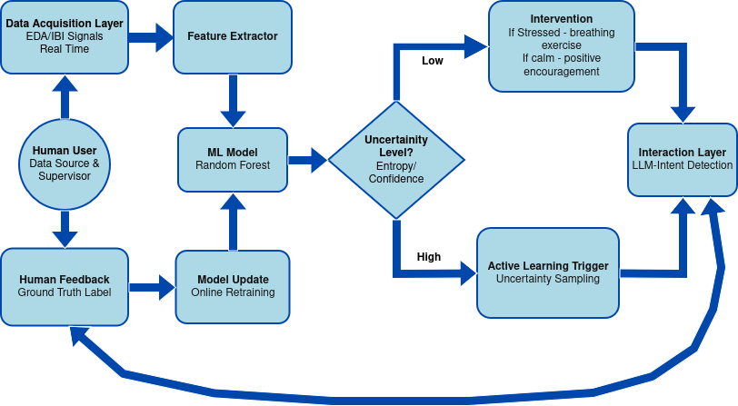

# Adaptive Stress Management

### A Human-in-the-Loop Framework using Active Learning and Physiological Computing

AI-driven personalized stress monitoring using physiological signals, uncertainty-aware machine learning, and conversational interaction.

---

## Overview

This project develops a real-time adaptive stress monitoring system that learns individual stress patterns over time.

Unlike static stress classifiers, this system:

* Detects stress from physiological signals
* Measures prediction uncertainty
* Asks the user when unsure
* Continuously personalizes the model

The result is a closed-loop, human-in-the-loop framework for personalized stress management.

---

## Key Features

* Real-time physiological stress detection
* Entropy-based uncertainty quantification
* Active Learning personalization
* LLM-based conversational feedback
* Human-in-the-loop adaptive framework

## Demo

Watch the system in action, demonstrating real-time physiological monitoring, uncertainty detection, and LLM-guided breathing exercises:

[](https://youtu.be/N7pSFLg5EGU?si=osRaXTtTeDiAN1s8)  
*(Click the image to watch the video on YouTube)*

---

## System Architecture


---

## [Real-Time Monitoring](real_time_monitoring/README.md)

The system processes physiological signals such as:

* Electrodermal Activity (EDA)
* Inter-Beat Interval (IBI) 

Pipeline:

1. Signal acquisition
2. Preprocessing & feature extraction
3. Sliding window classification
4. Stress prediction output

The system can operate on:

* Public datasets (e.g., WESAD)
* Simulated streams
* Real-time wearable data (e.g., Emotibit)


---

## [Active Learning](active_learning/README.md)

A key contribution of this project is uncertainty-driven personalization.

After each prediction:

* Prediction probabilities are computed
* Entropy is used to measure uncertainty

Decision logic:

* **Low uncertainty** → Deliver stress intervention
* **High uncertainty** → Ask the user for clarification

User feedback is then:

* Added as labeled data
* Used to update the model
* Improving personalization over time

This reduces the need for large labeled datasets and adapts to individual physiological differences.

---

## [Dialogue Manager](dialogue_manager/README.md)

When uncertainty is high, the system does not issue a rigid alert.
Instead, it triggers a natural language interaction powered by a Large Language Model (LLM).

Example interaction:

> “I’m noticing some changes in your signals. Are you feeling stressed right now or just physically active?”

The dialogue manager:

* Generates empathetic queries
* Interprets user responses
* Extracts feedback labels
* Feeds them back into the learning loop

This transforms the system from a passive detector into an interactive stress assistant.

---

## User Study

As part of the evaluation of this framework, a pilot user study was conducted. The study assessed user perception across several key domains of the system's design and deployment.

You can view the structure of the survey here: **[User Study Survey (SoSci Survey)](https://www.soscisurvey.de/test547949/)**

The survey evaluated:

* **Explainable AI (XAI):** Assessing user acceptance, comprehension, and preference for queries equipped with natural language explanations versus unexplained queries.
* **Privacy & Ethics:** Gauging user comfort levels with continuous physiological monitoring, data storage, and AI processing.
* **Future Test Subjects:** Collecting demographic and experiential data to inform future system iterations and broader deployments.

---

## Installation & Setup

To run this project locally, ensure you have a Python environment set up (virtual environment recommended). You can install all necessary dependencies using the provided `requirements.txt` file:

```bash
# Clone the repository
git clone https://git.inf.h-brs.de/dlr_project/stress-management-using-active-learning.git
cd stress-management-using-active-learning

# Install dependencies
pip install -r requirements.txt
```
---

## Notes

To access the trained model; please refer the following [repository](https://github.com/prachi0711/Stress-Management-using-Physiological-Signals-and-conversational-agents)

For detailed informantion; please refer the following [report](assets/ShethP-MTReport.pdf)


